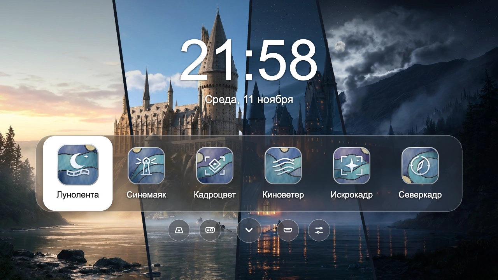

# Витрина — лаунчер для Android TV и проектора


**Витрина** собирает любимые приложения, часы и настройки проектора на одном экране. Интерфейс рассчитан на управление пультом.



*Фон разделён на четыре панели. Слева направо — утро, день, вечер и ночь. Названия и эмблемы приложений вымышлены.*

[Скачать APK версии 0.1.1](https://github.com/akonyaev-ru/projector-launcher/releases/tag/v0.1.1)

## ✨ Возможности

- **До шести приложений на главном экране.** Выбирайте из установленных приложений, добавляйте и переставляйте плитки с пульта.
- **Обои для четырёх времён суток.** Утренний, дневной, вечерний и ночной фон меняются автоматически. Часы и обои используют время устройства.
- **Круглые ярлыки под витриной.** Открывают список приложений, системные настройки, HDMI, коррекцию трапеции и настройки проектора. Три ярлыка проектора зависят от прошивки.

## 🎮 Управление пультом

| Действие | Кнопка |
| --- | --- |
| Выбрать плитку или ярлык | Стрелки |
| Открыть выбранное | **OK** |
| Показать все приложения | **↓** с плитки, затем **OK** или ещё раз **↓** |
| Добавить, убрать или переместить плитку | Удерживать **OK** или нажать **Menu** на плитке |
| Закрыть меню или список приложений | **Назад** |

## 💻 Системные требования

- Устройство на Android 9 (API 28) или новее. Работа с пультом и ярлыками проектора проверена на одной прошивке Android TV 13.
- Для сборки нужны JDK 17 и Android SDK с платформой API 34. Для установки с компьютера нужен `adb` из Android SDK Platform-Tools.

## 🛠 Сборка из исходников

Укажите путь к Android SDK в переменной `ANDROID_HOME` или в файле `local.properties`. Gradle Wrapper входит в репозиторий.

```bash
./gradlew :app:testDebugUnitTest :app:assembleRelease
```

Готовый APK — `app/build/outputs/apk/release/app-release.apk`. Для этой сборки Gradle использует локальный отладочный ключ.

## 🚀 Установка через ADB

Скачайте APK из релиза или соберите его из исходников и укажите путь к файлу в переменной `APK`. Включите отладку на устройстве. Для подключения по сети укажите адрес и порт, которые показывает ваш проектор.

```bash
APK=./vitrina-0.1.1.apk
PROJECTOR='IP_ПРОЕКТОРА:5555'
adb connect "$PROJECTOR"
adb -s "$PROJECTOR" install -r "$APK"
adb -s "$PROJECTOR" shell am start -n pro.icover.vitrina/.MainActivity
```

При подключении единственного устройства по USB используйте те же команды установки и запуска без `-s "$PROJECTOR"`. Для обновления APK должен быть подписан тем же ключом, что и установленная версия.

На протестированной прошивке скрипт [home-on.sh](tools/home-on.sh) назначает «Витрину» домашним экраном, а [home-off.sh](tools/home-off.sh) возвращает штатный лаунчер. Передайте адрес устройства через переменную `PROJECTOR` или запишите адрес с портом в файл `.projector-address` в корне проекта.
